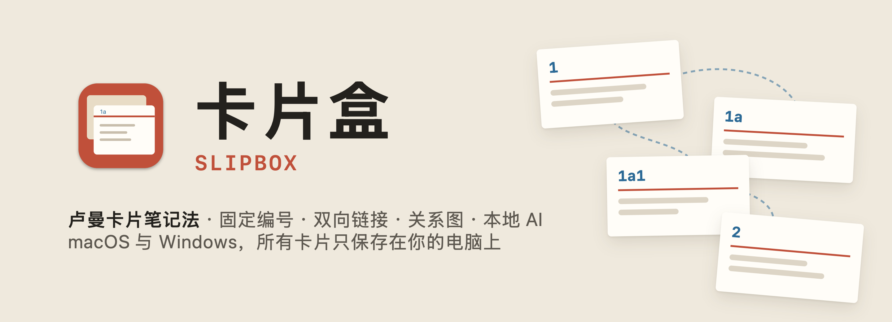
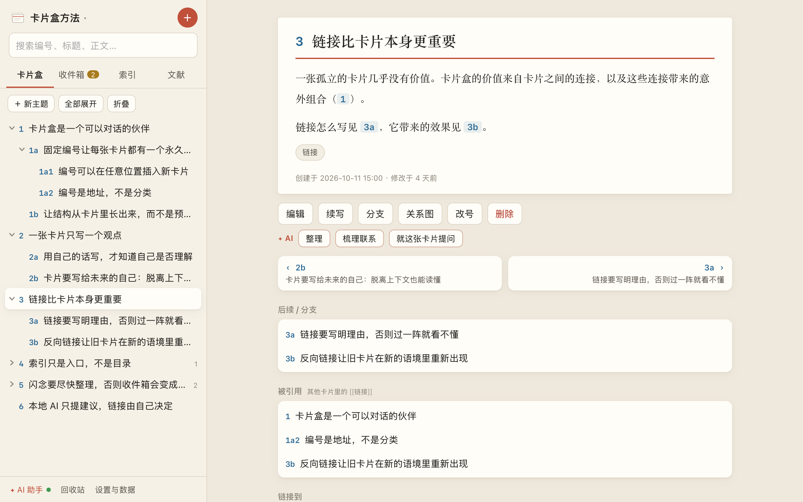
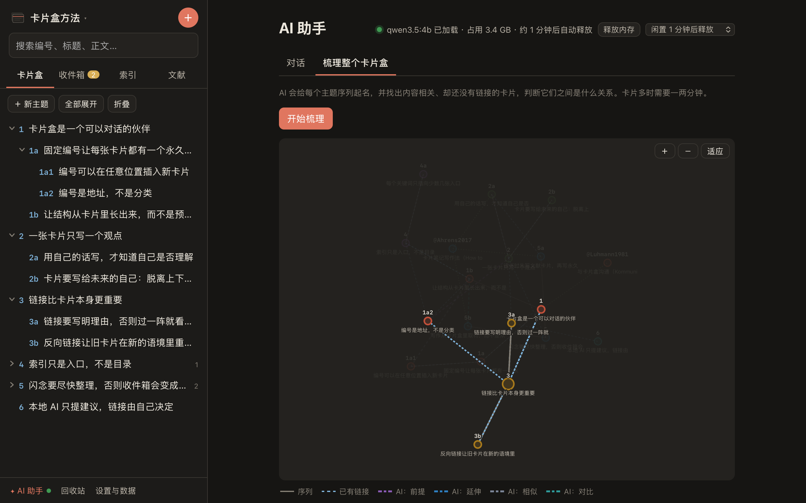
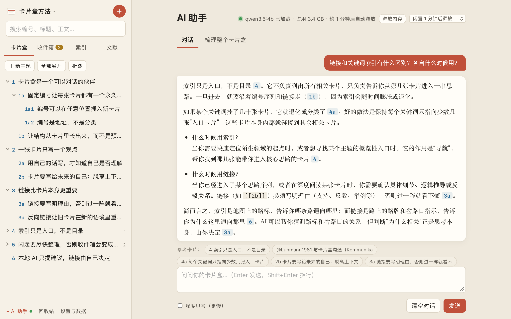
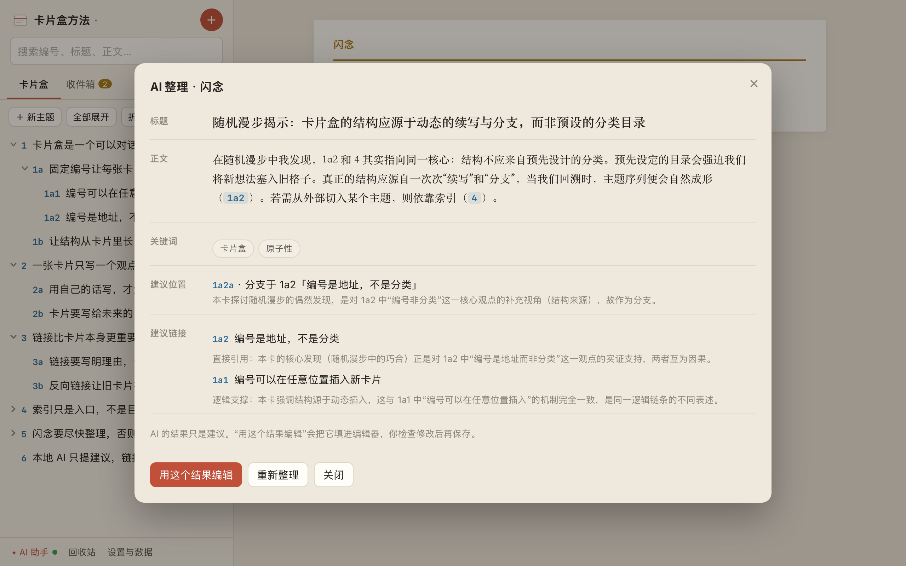
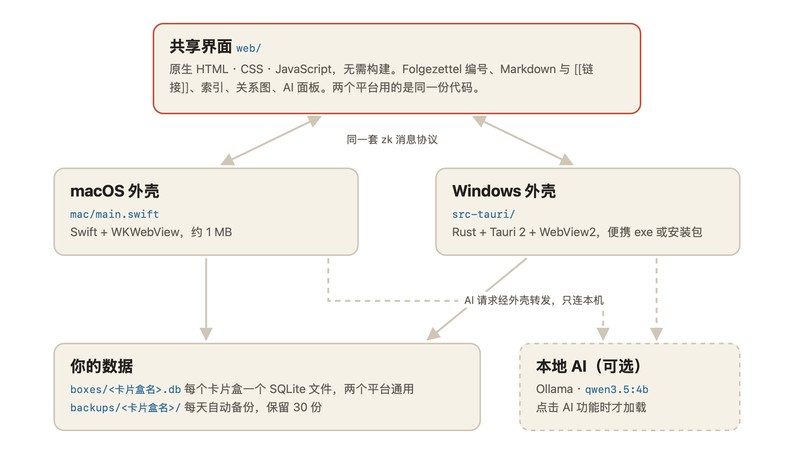

<div align="center">



**一个真正属于你的卢曼卡片盒。**

固定编号、双向链接、关键词索引、关系图和本地 AI，<br>
在 macOS 和 Windows 上运行，每一张卡片都只保存在你自己的电脑上。

[](https://github.com/CamLUzy/slipbox/releases/latest)
[](https://github.com/CamLUzy/slipbox/releases)
[](https://github.com/CamLUzy/slipbox/actions/workflows/build.yml)
[](#下载与安装)
[](LICENSE)
[](https://github.com/CamLUzy/slipbox/stargazers)

[下载 Windows 版](https://github.com/CamLUzy/slipbox/releases/latest) ·
[下载 macOS 版](https://github.com/CamLUzy/slipbox/releases/latest) ·
[使用指南](docs/README.md) ·
[示例卡片盒](docs/demo/demo-box.json) ·
[路线图](ROADMAP.md) ·
[更新日志](CHANGELOG.md) ·
[English](README.en.md)

</div>

<table align="center">
<tr>
<td align="center"><br><sub><b>卡片</b> · 编号序列、链接与反向链接</sub></td>
<td align="center"><br><sub><b>关系图</b> · 悬停一张卡片，只看它的联系</sub></td>
<td align="center"><br><sub><b>AI 助手</b> · 回答里的 [[编号]] 可以直接点开</sub></td>
</tr>
</table>

## 为什么做卡片盒

社会学家 Niklas Luhmann 用一个木头卡片盒写出了七十多本书。秘诀不在卡片本身，而在三件事：每张卡片有一个永远不变的编号，卡片之间写着理由的链接，以及一份很薄的关键词索引。卡片足够多之后，卡片盒会给出你自己都没想到的组合，他称之为“沟通伙伴”。

现在的笔记软件大多是文件夹加标签，或者把你的笔记放在别人的服务器上。卡片盒把卢曼的做法原样搬到电脑上：卡片有 `1`、`1a`、`1a1` 这样的固定编号，链接写在正文里，结构从一次次“续写”和“分支”中长出来。所有数据都是你电脑上的一个 SQLite 文件，不需要账号、不联网、没有订阅。

AI 只在你点 AI 按钮时才在本机启动，它可以帮你整理闪念、找出可能相关的卡片，但链接写不写，由你决定。

## 功能

**卢曼卡片盒**

- 三种卡片：闪念（收件箱）、文献卡片（书目卡片盒）、永久卡片（主卡片盒）。
- Folgezettel 固定编号：“续写”和“分支”自动算出下一个空位，可以无限插入。
- 正文写 `[[1a2]]` 链接卡片，`[[@Luhmann1981]]` 引用文献，输入 `[[` 自动补全；每张卡片都显示“被引用”。
- 关键词索引、编号树、按编号顺序翻上一张/下一张、随机漫步、全文搜索。
- 改号时整串分支一起移动，所有指向它们的链接自动更新。
- 多个卡片盒，按课程或项目分开；回收站、Markdown 正文、深色模式、快捷键。

**看见联系**

- 关系图：一张卡片两层之内的序列、链接和文献引用，可拖动、缩放。
- 鼠标放到任意节点上，无关的卡片淡出，相关的高亮。
- AI 梳理整个卡片盒：给每个主题序列起名，找出内容相关却还没链接的卡片对，按主题上色画成一张图。

**本地 AI（可选）**

- 用 [Ollama](https://ollama.com) 在本机运行，默认模型 `qwen3.5:4b`（约 3.3 GB）。只在点击时加载，闲置自动释放内存，界面实时显示状态。
- AI 整理：把一条闪念改写成合格的永久卡片，建议标题、关键词、编号位置和应该链接的卡片。
- AI 梳理联系：判断一张卡片和相近卡片的关系（支持、反驳、举例、延伸、前提、对比、相似）。
- AI 助手：先从卡片盒里找出相关卡片，再根据它们回答。
- 所有结果都只是建议，确认后才会写进卡片。应用只允许连接本机的 Ollama。

<p align="center"><br><sub>AI 整理：把一条闪念改写成永久卡片，并建议它在卡片盒里的位置</sub></p>

**你的数据**

- 每个卡片盒是一个 SQLite 文件，Mac 和 Windows 格式相同，可以直接拷过去用。
- 每天自动备份，保留 30 份；随时导出 JSON 或一个文件夹的 Markdown（带 front matter，Obsidian 等可以打开）。

## 下载与安装

到 [Releases](https://github.com/CamLUzy/slipbox/releases/latest) 下载：

| 系统 | 文件 | 说明 |
|---|---|---|
| **Windows 10 / 11** | `Slipbox-<版本>-windows-x64-setup.exe` | 安装版，装到当前用户，开始菜单里叫“卡片盒”。缺 WebView2 时会自动补装 |
| | `Slipbox-<版本>-windows-x64-portable.exe` | 便携版，双击即用，不写注册表（需要系统自带的 WebView2，Windows 11 和更新过的 Windows 10 都有） |
| **macOS 12+** | `Slipbox-<版本>-macos.zip` | 解压后把“卡片盒.app”拖进“应用程序”（Apple 芯片和 Intel 通用） |

每个文件旁边的 `SHA256SUMS.txt` 可以用来校验下载是否完整。

> [!NOTE]
> 应用没有购买代码签名证书。Windows 第一次打开时如果出现“Windows 已保护你的电脑”，点 **更多信息 → 仍要运行**。macOS 提示“无法验证开发者”时，到 **系统设置 → 隐私与安全性** 点 **仍要打开**，或在终端运行 `xattr -dr com.apple.quarantine /Applications/卡片盒.app`。

想先试试？在应用里点 **设置与数据 → 从 JSON 导入**，选择 [`docs/demo/demo-box.json`](docs/demo/demo-box.json)，就能得到截图里的示例卡片盒。

<details>
<summary><b>从源码构建</b></summary>

```bash
git clone https://github.com/CamLUzy/slipbox
cd slipbox
npm install          # Tauri CLI
npm test             # 编号规则与数据操作的单元测试

bash mac/build.sh --install   # macOS：只需要 Xcode 命令行工具
npx tauri build               # Windows：需要 Rust 与 WebView2，产物在 src-tauri/target/release/
```

两个平台的构建、自测和打包都在 [GitHub Actions](.github/workflows/build.yml) 里自动完成，细节见 [开发指南](docs/DEVELOPMENT.md)。

</details>

## 工作原理

<p align="center">
<picture>
  <source media="(prefers-color-scheme: dark)" srcset="docs/diagrams/architecture-dark.png">
  
</picture>
</p>

- **`web/`** 是整个界面：原生 HTML、CSS 和 JavaScript，没有框架、不需要构建。编号规则（`luhmann.js`）和所有数据操作（`ops.js`）都是纯函数，旁边有单元测试。
- **`mac/main.swift`** 是 macOS 外壳：一个 WKWebView 窗口，加上 SQLite、菜单栏、存储面板和自动备份，编译出来约 1 MB。
- **`src-tauri/`** 是 Windows 外壳：Rust + Tauri 2，用系统自带的 WebView2 显示同一份界面。
- 两个外壳回答同一套 `zk` 消息（读写卡片、管理卡片盒、备份、导出、AI 代理），所以界面代码在两个平台上完全一样。
- 两个外壳都带一个无窗口的自测模式，CI 每次都会在真正的 Windows 和 macOS 上打开打包好的应用，跑一遍读写、改号、备份和页面渲染。

### 你的数据

所有内容都在一个文件夹里：Windows 是 `%APPDATA%\卡片盒`，macOS 是 `~/Library/Application Support/卡片盒`。

| 路径 | 内容 |
|---|---|
| `boxes/<卡片盒名>.db` | 一个卡片盒的全部卡片（SQLite，每张卡片一行，`data` 列是完整 JSON） |
| `backups/<卡片盒名>/zettel-日期.db` | 每天一份自动备份，保留最近 30 份 |
| `settings.json`（Windows） | 上次打开的卡片盒 |

备份这个文件夹，就备份了一切。换电脑时把它拷过去即可，Mac 和 Windows 之间也通用。

## 文档

| 我想 | 看这里 |
|---|---|
| 先了解卡片盒方法和这个应用怎么用 | [使用指南](docs/README.md) |
| 在 Windows 上安装、升级、卸载 | [Windows](docs/WINDOWS.md) |
| 在 Mac 上安装或自己编译 | [macOS](docs/MAC.md) |
| 打开本地 AI | [本地 AI](docs/AI.md) |
| 备份、导入导出、换电脑 | [数据](docs/DATA.md) |
| 找常见问题的答案 | [FAQ](docs/FAQ.md) |
| 参与开发 | [开发指南](docs/DEVELOPMENT.md) · [贡献](CONTRIBUTING.md) |
| 报告安全问题 | [安全](SECURITY.md) |

## 路线图

完整计划在 [ROADMAP.md](ROADMAP.md)。

| 版本 | 时间 | 主题 |
|---|---|---|
| v1.0.0 | 2026 年 10 月 | macOS 与 Windows 应用、多个卡片盒、本地 AI、关系图 |
| v1.1 | 下一个 | iPhone / iPad 应用（同一份界面，Tauri iOS 外壳） |
| v1.2 | 之后 | 设备之间同步：通过你自己的网盘文件夹，不经过任何服务器 |
| 以后 | | 图片附件、卡片历史版本、向量检索的“可能相关的卡片” |

## 参与

- **[Issues](https://github.com/CamLUzy/slipbox/issues)**：可以复现的 bug 和具体的功能建议。
- **[Discussions](https://github.com/CamLUzy/slipbox/discussions)**：使用方法、卡片盒心得、想法。
- **[Pull requests](https://github.com/CamLUzy/slipbox/pulls)** 欢迎，先看 [CONTRIBUTING.md](CONTRIBUTING.md)。

## 许可证

[MIT](LICENSE)。卡片盒方法属于 Niklas Luhmann，这个应用只是把它搬到了电脑上。
