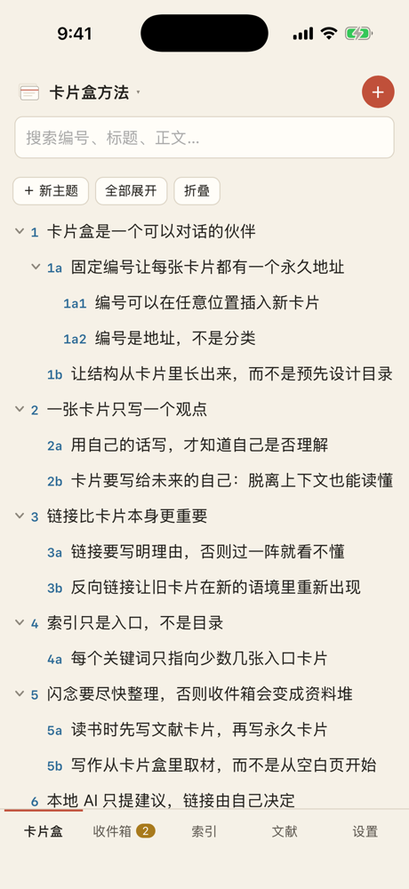
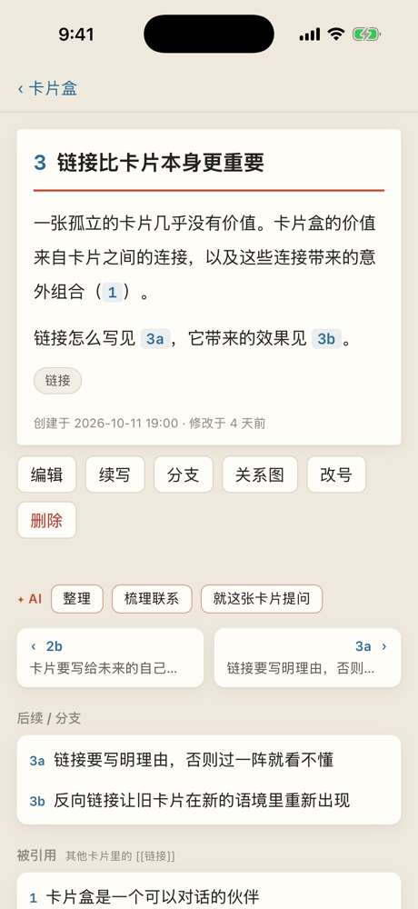
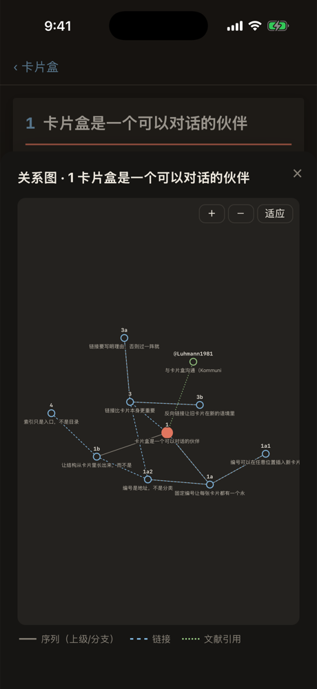
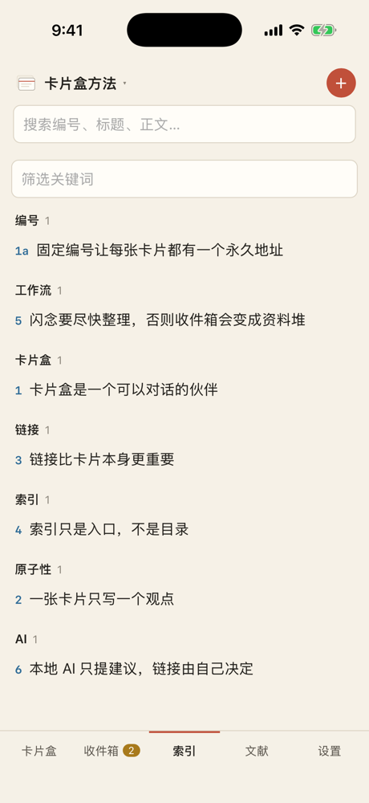

# iPhone / iPad

支持 iOS / iPadOS 16 及以上。界面和桌面版是同一份代码，手机上是底部标签栏的单栏布局，iPad 横屏时是双栏布局。

<table align="center">
<tr>
<td align="center"><br><sub>编号树</sub></td>
<td align="center"><br><sub>卡片</sub></td>
<td align="center"><br><sub>关系图</sub></td>
<td align="center"><br><sub>关键词索引</sub></td>
</tr>
</table>

## 安装

卡片盒没有上架 App Store（需要付费开发者账号），所以 iPhone 版需要自己装。下面两种方式任选一种，都只需要一个免费的 Apple ID。

### 方式一：用 Sideloadly 或 AltStore 安装 `.ipa`（不需要 Xcode）

1. 在 [Releases](https://github.com/CamLUzy/slipbox/releases/latest) 下载 `Slipbox-<版本>-ios-unsigned.ipa`。
2. 在电脑上安装 [Sideloadly](https://sideloadly.io)（Windows / macOS）或 [AltStore](https://altstore.io)。
3. 用数据线连接 iPhone，把 `.ipa` 拖进 Sideloadly，填入你的 Apple ID，点 Start。工具会用你的 Apple ID 给应用签名并装到手机上。
4. 第一次打开前，到 iPhone 的 **设置 → 通用 → VPN 与设备管理**，信任你的 Apple ID。

免费 Apple ID 签名的应用 **7 天后需要重新签名**（AltStore 可以在同一个 Wi-Fi 下自动续签）。重新签名不会影响卡片数据。

### 方式二：用 Xcode 从源码安装

需要一台装了完整 Xcode 的 Mac：

```bash
brew install xcodegen
git clone https://github.com/CamLUzy/slipbox && cd slipbox/ios
xcodegen            # 生成 Slipbox.xcodeproj
open Slipbox.xcodeproj
```

在 Xcode 里选择 Slipbox target → Signing & Capabilities → Team 选你的 Apple ID，连接 iPhone 后点 Run。

## 数据在哪

卡片保存在应用自己的“文稿”文件夹里，打开 **“文件”App → 我的 iPhone → 卡片盒** 就能看到：

```
卡片盒/
├─ boxes/<卡片盒名>.db        和 Mac、Windows 完全相同的 SQLite 文件
├─ backups/<卡片盒名>/        每天自动备份
└─ 已删除的卡片盒/            删除的卡片盒先放这里，可以拖回 boxes/ 恢复
```

所以可以直接用“文件”App、AirDrop 或网盘把 `.db` 文件在 iPhone 和电脑之间拷来拷去。设备之间一键同步的计划见 [多端互联](SYNC.md)。

导入导出：**设置与数据 → 导出 JSON** 会打开分享面板（可以存到“文件”或 AirDrop 给电脑）；**从 JSON 导入** 会打开文件选择器。

## 本地 AI

iPhone 上跑不了 Ollama，但可以用同一个 Wi-Fi 下电脑上的：

1. 在电脑上让 Ollama 接受局域网连接：macOS 运行 `launchctl setenv OLLAMA_HOST 0.0.0.0` 后重启 Ollama；Windows 在“系统 → 高级系统设置 → 环境变量”里添加 `OLLAMA_HOST=0.0.0.0`，再重启 Ollama。
2. 查出电脑的局域网地址（比如 `192.168.1.20`）。
3. 在 iPhone 的卡片盒里打开 **设置与数据 → AI**，把 Ollama 地址改成 `http://192.168.1.20:11434`，保存。
4. 第一次连接时 iPhone 会请求“本地网络”权限，选允许。

应用只允许连接本机或局域网地址（`10.*`、`172.16–31.*`、`192.168.*`、`*.local`），卡片不会被发到互联网上的服务器。

## 已知限制

- 没有菜单栏和键盘快捷键（外接键盘时 `N`、`/`、`J` / `K` 等单键快捷键仍然可用）。
- 免费签名每 7 天要续一次。
